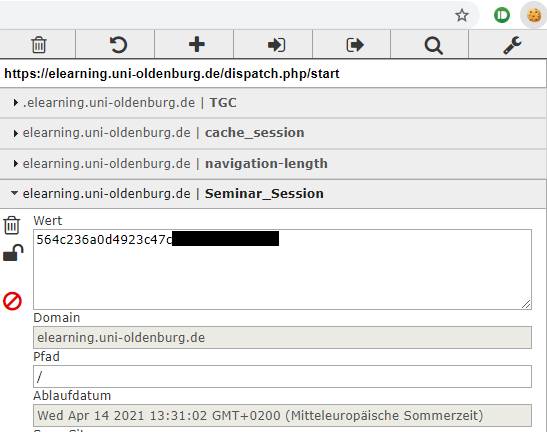

# StudIP-Downloader
Ein kleines Tool, um die Dateien aller Kurse aus dem StudIP herunterzuladen. Aktuell nur für die Uni Oldenburg getestet. Andere Universitäten und Hochschulen, die StudIP verwenden, sollten aber auch funktionieren.

Seit Version 2.0 wird die Stud.IP **JSON:API** (`jsonapi.php/v1/`) verwendet. Die alte REST-API (`api.php`) wurde mit Stud.IP 6.0 entfernt.
Die JSON:API ist ab Stud.IP 4.x verfügbar.

## Download
https://github.com/yannik995/StudIP-Downloader/releases

Die Releases sind eigenständig lauffähig (self-contained, .NET 8) für Windows, Linux und macOS. Es muss keine .NET Runtime installiert werden.

### Wie wird das Tool verwendet?

1. Zip Archiv herunterladen, entpacken.
2. StudIPDownloader.exe starten, StudIP URL eintragen z.B.: https://elearning.uni-oldenburg.de/
3. Wert des Session Cookies aus dem Browser eintragen. Der Cookie heißt seit Stud.IP 6.0 `Studip_Session`, in älteren Versionen `Seminar_Session`.
(Einloggen und Cookies z.B. über die Entwicklertools des Browsers (F12 → Speicher/Application → Cookies) anzeigen lassen:

)

Alternativ können auch Benutzername und Passwort als Parameter hinter der Anwendung eingetragen werden und optional ein zusätzliches True, um die Daten zu speichern:
`StudIPDownloader.exe Username Passwort True`

Der Login mit Benutzername und Passwort wird zuerst per HTTP Basic Auth versucht. Ist das auf dem Server deaktiviert, wird über das normale Stud.IP Login-Formular eingeloggt. Bei Single Sign-On (z.B. Shibboleth) funktioniert das nicht, dann bitte den Cookie verwenden.

Der Cookie kann auch direkt als Parameter übergeben werden: `StudIPDownloader.exe CookieWert`

4. Lokalen Pfad eintragen
5. Nun werden alle Dateien heruntergeladen

Die Einstellungen werden in der `config.ini` gespeichert und beim nächsten Start muss nur ggf. der Wert des Cookies neu eingetragen werden.

Es werden immer nur die neuen oder geänderten Dateien heruntergeladen. Das Änderungsdatum der heruntergeladenen Dateien wird auf das Änderungsdatum im Stud.IP gesetzt.

### Einstellungen (config.ini)

| Schlüssel | Beschreibung |
|---|---|
| `StudIP` | URL der Stud.IP Installation, z.B. `https://elearning.uni-oldenburg.de/` oder `https://e-learning.tuhh.de/studip/` |
| `Cookie` | Wert des `Studip_Session` (bzw. `Seminar_Session`) Cookies |
| `User` / `Pass` | Benutzername und Passwort (optional, statt Cookie) |
| `savePass` | `True`, um das Passwort in der config.ini zu speichern |
| `Pfad` | Lokaler Zielordner |
| `express` | `True`: Nur Veranstaltungen des aktuellen Semesters synchronisieren |
| `ignore` | Kommagetrennte Liste von Ordnernamen, die übersprungen werden, z.B. `720p,Videos` |
| `ignoreCourses` | Kommagetrennte Liste von Veranstaltungen, die übersprungen werden (Blacklist) |
| `onlyCourses` | Kommagetrennte Liste von Veranstaltungen. Wenn gesetzt, werden nur diese synchronisiert (Whitelist) |
| `downloadOverwrite` | `True`: Auch Dateien herunterladen, die nicht als downloadbar markiert sind |

Bei `ignoreCourses` und `onlyCourses` kann jeweils ein Teil des Veranstaltungstitels, die Veranstaltungsnummer oder die Veranstaltungs-ID angegeben werden (Groß-/Kleinschreibung egal).

Siehe auch [config.ini.sample](./config.ini.sample).

